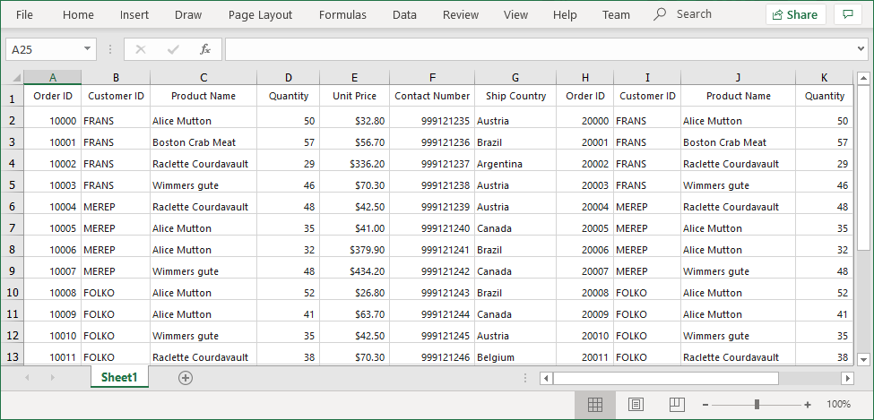

# How to Export the Multiple WinForms DataGrid into Single Worksheet in Excel?

This sample illustrates how to export multiple [WinForms DataGrid](https://www.syncfusion.com/winforms-ui-controls/datagrid) (SfDataGrid) into single worksheet in excel.

In `DataGrid` control, you can export data to Excel by using the `ExportToExcel` method. If you want export multiple DataGrid's to single excel sheet , you need to merge the one SfDataGrid WorkSheet into another SfDataGrid WorkSheet using `Worksheet.UsedRange.CopyTo` method like the below code example.

```c#
using Syncfusion.WinForms.DataGridConverter;
using Syncfusion.XlsIO;
private void OnExportButton_Click(object sender, EventArgs e)
{
    var options = new ExcelExportingOptions();
    
    var excelEngine = sfDataGrid1.ExportToExcel(sfDataGrid1.View, options);
    var workBook1 = excelEngine.Excel.Workbooks[0];
    var worksheet1 = workBook1.Worksheets[0];

    excelEngine = sfDataGrid2.ExportToExcel(sfDataGrid2.View, options);
    var workBook2 = excelEngine.Excel.Workbooks[0];
    var worksheet2 = workBook2.Worksheets[0];

    var columnCount = sfDataGrid2.Columns.Count;

    //Merge the One SfDataGrid WorkSheet into the other SfDataGrid WorkSheet
    worksheet2.UsedRange.CopyTo(worksheet1[1, columnCount + 1]);
    workBook1.SaveAs("sample.xlsx");
    }
}
```

